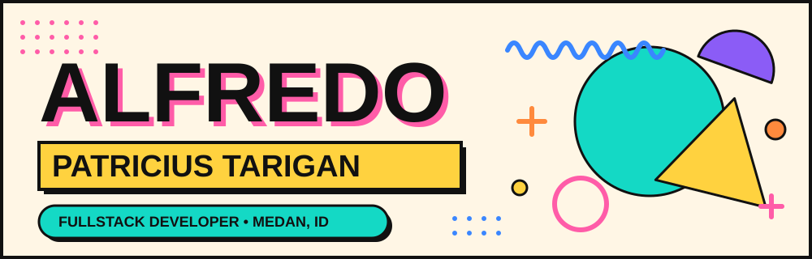
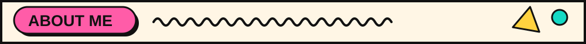
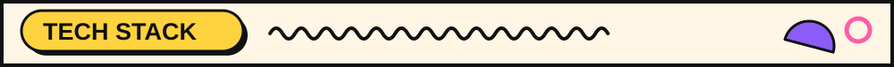
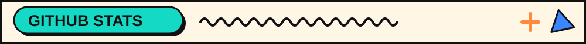
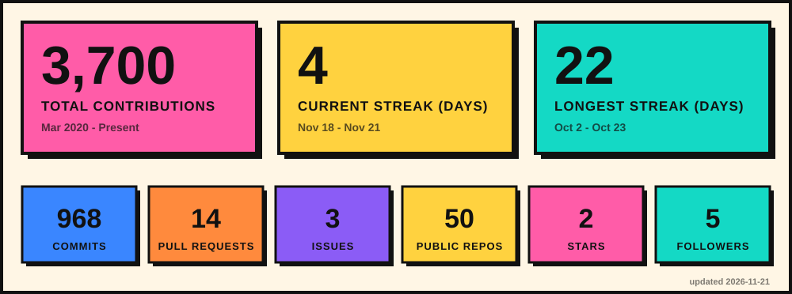
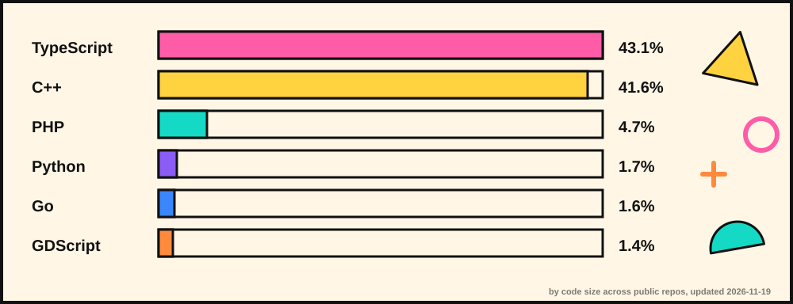
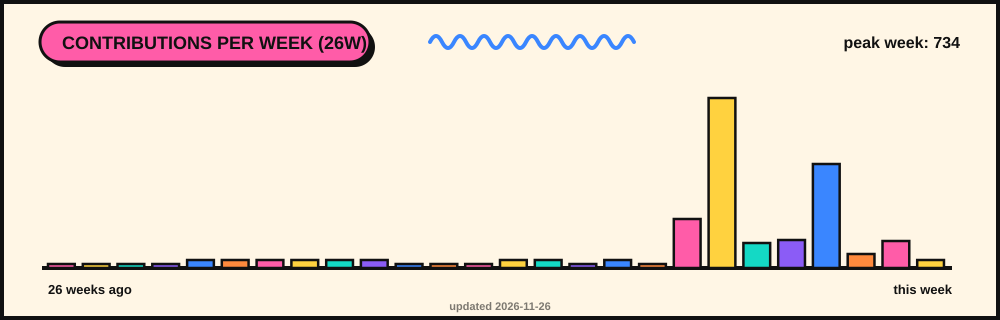
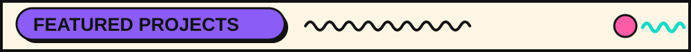
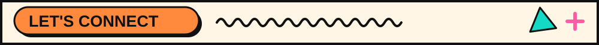

&nbsp;

Hi, I'm **Alfredo**, a fullstack developer from Medan, North Sumatra. I started out with **PHP (Laravel)** and **Flutter**, and these days I spend most of my time building APIs, dashboards, and the occasional game.

- 🔭 **Building:** HM BTN Re-Works (a native port of Harvest Moon: Back to Nature) and Plip!, a cozy fishing game
- 🌱 **Exploring:** Rust, Godot (GDScript), Swift, and microservices with gRPC/Protobuf
- 💼 **Worked on:** edutech apps, finance apps, and a city treasury app (Aplikasi Bendahara Walikota Medan)
- 💬 **Ask me about:** Go, TypeScript, Laravel, Flutter, and backend architecture
- ⚡ **Fun fact:** I build tools for fun too, like a job crawler and a dev sentinel in Rust

&nbsp;

&nbsp;

**Languages**

**Backend & Frameworks**

**Databases, DevOps & Tools**

&nbsp;

&nbsp;

  

  

&nbsp;

&nbsp;

| Project | Description | Stack |
| :-- | :-- | :-- |
| [**hm-btn-reworks**](https://github.com/alfredoptarigan/hm-btn-reworks) | Native port of Harvest Moon: Back to Nature from its decomp. Bring your own disc. |  |
| [**plip-game**](https://github.com/alfredoptarigan/plip-game) | Plip! A cozy fishing game, with a Rust server and Blender-made assets. |   |
| [**aru-finance-app**](https://github.com/alfredoptarigan/aru-finance-app) | Personal finance app with its own API and admin dashboard. |  |
| [**tabunganku-app**](https://github.com/alfredoptarigan/tabunganku-app) | Tabunganku savings app, built with Flutter and love, backed by a Go API. |   |
| [**whatsapp-official-backend-go**](https://github.com/alfredoptarigan/whatsapp-official-backend-go) | Backend for the official WhatsApp API, written in Go. |  |
| [**dev-sentinel**](https://github.com/alfredoptarigan/dev-sentinel) | Developer tooling built in Rust. |  |
| [**app-bendahara-bkad-laravel**](https://github.com/alfredoptarigan/app-bendahara-bkad-laravel) | Treasury app for the Medan city government (2024). |  |

&nbsp;

&nbsp;

<!-- Add your own links below, then remove this comment:

-->

  

